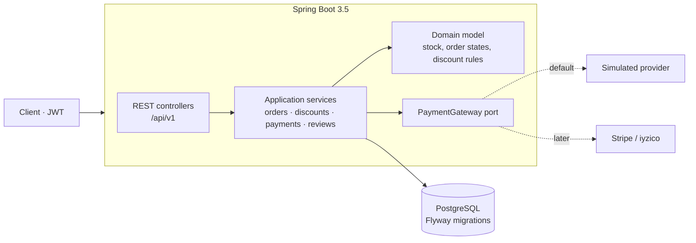

<div align="center">

# E-Commerce Backend

**A Spring Boot REST API for an online shop: catalogue, cart, discount codes, orders, payments with refunds and moderated reviews.**

[](https://github.com/akifkeklik/ecommerce-backend/actions/workflows/java-ci.yml)
[](LICENSE)


</div>

The interesting part is not the CRUD but what happens when money and stock are involved: two customers buying the
last item, a discount code with one use left, a payment that is declined and retried, an order cancelled after it
was paid. Each of these has a rule in the code and a test that proves it.

## What it does

| Area | Behaviour |
|---|---|
| **Auth** | Register, login, refresh-token rotation, logout. Access and refresh tokens carry different purposes; a refresh token cannot call the API. |
| **Catalogue** | Products, categories, search, featured items; draft and published states. |
| **Cart** | Customer cart and guest cart (per session), merged after login. |
| **Orders** | Stock is reserved under a row lock, so the last unit cannot be sold twice. Cancelling releases the reservation or restores sold stock. |
| **Discount codes** | Percentage and fixed amount. Validity window, total and per-customer limits, first-order codes, minimum amount, product and category scope. The code row is locked at checkout; cancelling gives the use back. |
| **Payments** | `POST /api/v1/orders/{id}/payments` charges a pending order and confirms it. Declined → 402, retry allowed. Paying again returns the same payment, never a second charge. Cancelling a paid order refunds it; a refused refund rolls the cancellation back. |
| **Reviews** | One per customer and product, shown after admin approval. "Verified purchase" from delivered orders. One helpful vote per reader. |

## Architecture



Payment providers sit behind a `PaymentGateway` interface. The default implementation is **simulated**: no money
moves, and the tokens `tok_decline` and `tok_insufficient_funds` produce declines. A real provider is a new
implementation selected with `PAYMENT_PROVIDER`; the API only ever receives provider tokens, never card numbers.

| Area | Technologies |
|---|---|
| Runtime | Java 17, Spring Boot 3.5, Spring Web, Spring Security, Spring Data JPA |
| Data | PostgreSQL 16, Flyway, Redis (configuration) |
| Quality | JUnit 5, Mockito, MockMvc, Testcontainers, JaCoCo, GitHub Actions |
| Delivery | Docker, Docker Compose, SpringDoc OpenAPI |

## Run locally

Requires JDK 17, Maven and Docker.

```bash
cp .env.example .env                      # set JWT_SECRET: openssl rand -base64 32
docker compose up -d postgres redis mailhog
export JWT_SECRET="$(openssl rand -base64 32)"   # PowerShell: $env:JWT_SECRET = "<value>"
mvn spring-boot:run -Dspring-boot.run.profiles=dev
```

- API: `http://localhost:8080`
- Swagger UI: `http://localhost:8080/swagger-ui.html`
- Health: `http://localhost:8080/actuator/health`

The whole stack in containers: `docker compose up -d --build` (after setting `JWT_SECRET` in `.env`).
The Compose credentials are for local development only.

## Deploy

[](https://render.com/deploy?repo=https://github.com/akifkeklik/ecommerce-backend)

`render.yaml` creates the API and a PostgreSQL database on Render's free tier; Flyway builds the schema on the
first start and Swagger UI is served at `/swagger-ui.html`. The free API sleeps after 15 minutes idle, and Render's
free database expires after 30 days. A test (`RenderBlueprintStartupTest`) starts the app with exactly this
blueprint on PostgreSQL in CI, so a broken deployment setting fails the build, not the deploy.

## Tests

```bash
mvn test
```

59 tests run on every pull request:

- **End to end through HTTP** on the real Spring context: an order with a discount code, a second use refused,
  payment by another customer refused, a declined then approved payment, no double charge, cancellation that
  refunds and restores stock and the code, then review moderation and helpful votes.
- **Migrations on real PostgreSQL:** every Flyway migration is applied in a Testcontainers PostgreSQL 16 and the
  context starts with `ddl-auto=validate`, the same check production runs at start-up.
- **Unit tests** for discount rules, payments, refunds, order states, product stock, JWT and the rate limiter.

## Design notes

- **Locks where money is involved:** product rows during reservation, the discount row during checkout, the order
  row during payment.
- **Failures are recorded, not lost:** a declined payment is saved with the provider's code before the 402 is
  returned, so it can be retried on the same row.
- **Rate limiting** is in memory with a client cap and idle eviction. It protects one instance; several instances
  would need a shared store such as Redis.
- **Old tokens:** tokens issued before purpose claims existed are rejected; users sign in again once.

## Limits

- Payments use the simulated provider; there is no live Stripe, iyzico or PayPal integration.
- Shipping has a model and migration but no carrier integration; admins move orders through shipped and delivered.
- Free-shipping and buy-X-get-Y codes exist in the model but are rejected at checkout until shipping and bundle
  pricing exist.
- Not deployed publicly. Configure secrets, CORS, logging and monitoring before any public deployment.

## License

[MIT](LICENSE) · Built by [Akif Keklik](https://github.com/akifkeklik)
