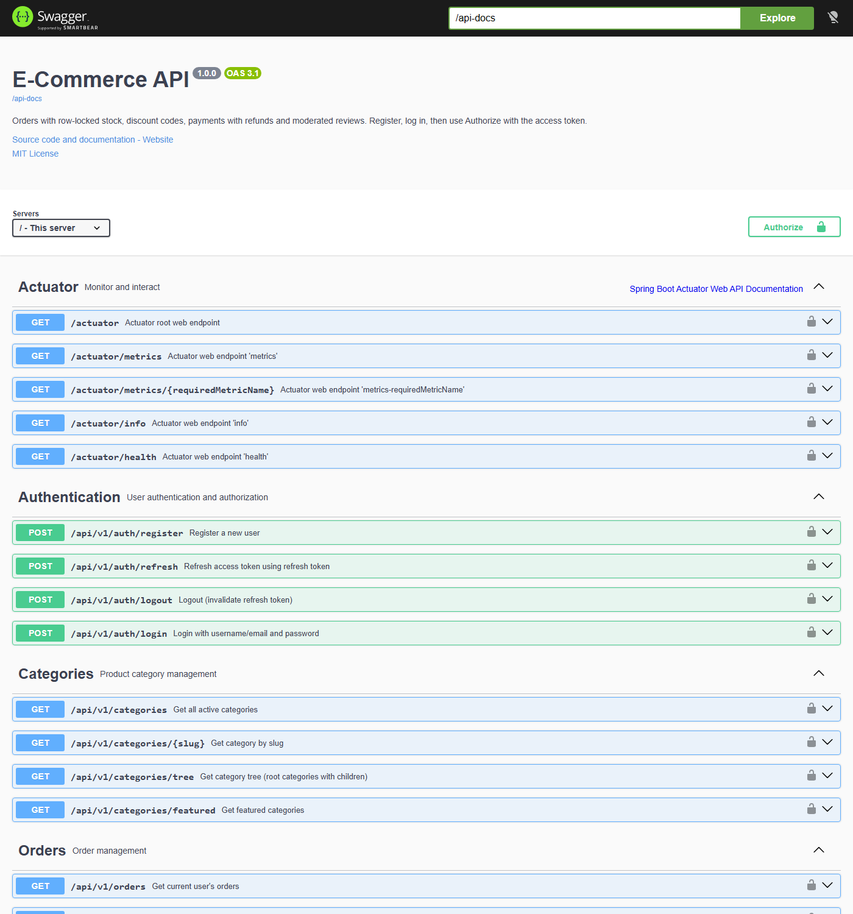
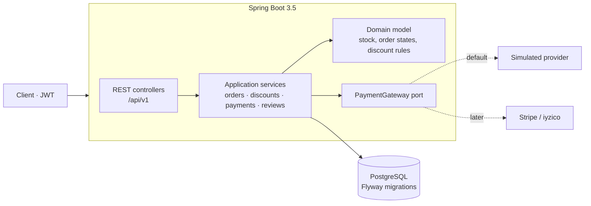

<div align="center">

# E-Commerce Backend — Orders, Stock, Discounts & Payments API

**A Spring Boot REST API for an online shop: catalogue, cart, discount codes, orders, payments with refunds and moderated reviews.**

**[Live API docs (Swagger UI)](https://ecommerce-backend-api-rxk3.onrender.com/swagger-ui.html)**

[](https://github.com/akifkeklik/ecommerce-backend/actions/workflows/java-ci.yml)
[](LICENSE)




<sub>Interactive API documentation (Swagger UI). Register, log in, click <b>Authorize</b> with the access token and try every endpoint.</sub>

</div>

> **Project:** E-Commerce Backend, a REST API portfolio project
> **Developer:** [Akif Keklik](https://github.com/akifkeklik)
> **Live API docs:** https://ecommerce-backend-api-rxk3.onrender.com/swagger-ui.html
> **Repo:** https://github.com/akifkeklik/ecommerce-backend

E-Commerce Backend is a **Spring Boot 3.5** API on **PostgreSQL** with **Flyway** migrations. The interesting part is not the CRUD but what happens when money and stock are involved: two customers buying the **last item**, a **discount code with one use left**, a payment that is **declined and retried**, an order **cancelled after it was paid**. Each of these has a rule in the code, guarded by **row locks** where it matters, and a test that proves it.

---

## At a glance

- Auth: **JWT access and refresh tokens** with rotation; a refresh token cannot call the API
- Orders: stock **reserved under a row lock**, so the last unit cannot be sold twice
- Discounts: percentage or fixed, validity window, **total and per-customer limits**, product and category scope
- Payments: **declines return 402 and can be retried**, paying twice never charges twice, cancelling a paid order **refunds** it
- Reviews: one per customer and product, **admin moderation**, verified-purchase badge
- Quality: **59 tests**, including every migration on **real PostgreSQL (Testcontainers)**

---

## Tech stack

| Area | Technologies |
|---|---|
| Runtime | Java 17, Spring Boot 3.5, Spring Web, Spring Security, Spring Data JPA |
| Data | PostgreSQL 16, Flyway, Redis (configuration) |
| Quality | JUnit 5, Mockito, MockMvc, Testcontainers, JaCoCo, GitHub Actions |
| Delivery | Docker, Docker Compose, SpringDoc OpenAPI, Render, Neon |

---

## Core features

### 1) Authentication
- Register, login, **refresh-token rotation** and logout.
- Access and refresh tokens carry different purposes; tokens issued before purpose claims existed are rejected.

### 2) Catalogue
- Products, categories, search and featured items, with **draft and published** states.

### 3) Cart
- Customer cart and **guest cart** (per session), merged after login.

### 4) Orders and stock
- Each product row is **locked while its stock is reserved**.
- Cancelling releases the reservation or restores sold stock.

### 5) Discount codes
- Percentage and fixed amount; validity window, total and per-customer limits, **first-order codes**, minimum amount, product and category scope.
- The code row is **locked at checkout**; cancelling gives the use back.

### 6) Payments and refunds
- `POST /api/v1/orders/{id}/payments` charges a pending order and confirms it.
- Declined → **402**, retry allowed on the same payment row. Paying again returns the same payment, never a second charge.
- Cancelling a paid order refunds it; **a refused refund rolls the cancellation back**.

### 7) Reviews
- One review per customer and product, shown **after admin approval**.
- "Verified purchase" from delivered orders, and one helpful vote per reader.

---

## Architecture



Payment providers sit behind a `PaymentGateway` interface. The default implementation is **simulated**: no money
moves, and the tokens `tok_decline` and `tok_insufficient_funds` produce declines. A real provider is a new
implementation selected with `PAYMENT_PROVIDER`; the API only ever receives provider tokens, never card numbers.

### Main packages (`src/main/java/com/ecommerce/`)
- **`api/v1`**: REST controllers and request/response mapping
- **`application/service`**: use cases such as `OrderService`, `DiscountService`, payments and reviews
- **`domain`**: `cart`, `order`, `payment`, `product`, `promotion`, `review`, `shipping`, `user`
- **`infrastructure`**: repositories, security (JWT, rate limiting), configuration and the simulated payment provider

---

## How an order works, step by step

### A) Checkout (`OrderService.createOrder`)
1. A new order is created as **Pending**, with shipping and billing addresses (billing defaults to shipping).
2. For each item, the product is loaded **with a row lock** (`findActiveByIdForUpdate`).
3. If the available quantity is too low, the whole order fails with `InsufficientStockException`; otherwise the quantity is **reserved**.
4. If a discount code is given, it is validated and its use is recorded **in the same transaction**: a rejected code fails the whole order.
5. Totals are calculated: `subtotal + shipping + tax − discount`, and the order is saved.

### B) Payment
1. The customer pays the pending order with a provider token; the **order row is locked**.
2. **Approved:** the payment is saved and the order becomes **Confirmed**.
3. **Declined:** the failure is saved with the provider's code, the API returns **402**, and the customer can retry on the same payment row.
4. Paying an already-paid order returns the existing payment.

### C) Cancellation
1. Only orders in a cancellable state can be cancelled.
2. The discount use is **given back** and the stock reservation released (or sold stock restored).
3. A paid order is **refunded** first; if the provider refuses the refund, the cancellation is rolled back and the order stays as it was.

Admins then move confirmed orders through shipped and delivered; delivered orders unlock the "verified purchase" badge on reviews.

---

## Setup and running

### Requirements
- JDK 17
- Maven
- Docker

### Clone
```bash
git clone https://github.com/akifkeklik/ecommerce-backend.git
cd ecommerce-backend
```

### Configure
```bash
cp .env.example .env                      # set JWT_SECRET: openssl rand -base64 32
```

### Run
```bash
docker compose up -d postgres redis mailhog
export JWT_SECRET="$(openssl rand -base64 32)"   # PowerShell: $env:JWT_SECRET = "<value>"
mvn spring-boot:run -Dspring-boot.run.profiles=dev
```

- API: `http://localhost:8080`
- Swagger UI: `http://localhost:8080/swagger-ui.html`
- Health: `http://localhost:8080/actuator/health`

The whole stack in containers: `docker compose up -d --build` (after setting `JWT_SECRET` in `.env`).
The Compose credentials are for local development only.

### Test
```bash
mvn test
```

59 tests run on every pull request:

- **End to end through HTTP** on the real Spring context: an order with a discount code, a second use refused,
  payment by another customer refused, a declined then approved payment, no double charge, cancellation that
  refunds and restores stock and the code, then review moderation and helpful votes.
- **Migrations on real PostgreSQL:** every Flyway migration is applied in a Testcontainers PostgreSQL 16 and the
  context starts with `ddl-auto=validate`, the same check production runs at start-up.
- **Unit tests** for discount rules, payments, refunds, order states, product stock, JWT and the rate limiter.

---

## Live demo

**[Swagger UI → ecommerce-backend-api-rxk3.onrender.com/swagger-ui.html](https://ecommerce-backend-api-rxk3.onrender.com/swagger-ui.html)**

The API runs on Render's free tier from `render.yaml`; the database is PostgreSQL on Neon's free plan, connected over
SSL (Flyway builds the schema on start).
The first request after 15 minutes idle wakes the server, which takes about a minute. The catalogue starts empty:
register, then try the endpoints from Swagger UI. A test (`RenderBlueprintStartupTest`) starts the app with exactly
this blueprint on PostgreSQL in CI, so a broken deployment setting fails the build, not the deploy.

---

## Design notes

- **Locks where money is involved:** product rows during reservation, the discount row during checkout, the order
  row during payment.
- **Failures are recorded, not lost:** a declined payment is saved with the provider's code before the 402 is
  returned, so it can be retried on the same row.
- **Rate limiting** is in memory with a client cap and idle eviction. It protects one instance; several instances
  would need a shared store such as Redis.
- **Old tokens:** tokens issued before purpose claims existed are rejected; users sign in again once.

## Limits

- Payments use the simulated provider; there is no live Stripe, iyzico or PayPal integration.
- Shipping has a model and migration but no carrier integration; admins move orders through shipped and delivered.
- Free-shipping and buy-X-get-Y codes exist in the model but are rejected at checkout until shipping and bundle
  pricing exist.

> **Note:** The public demo is for trying the API. Configure secrets, CORS, logging and monitoring before using it for anything real.

## License

[MIT](LICENSE) · Built by [Akif Keklik](https://github.com/akifkeklik)
